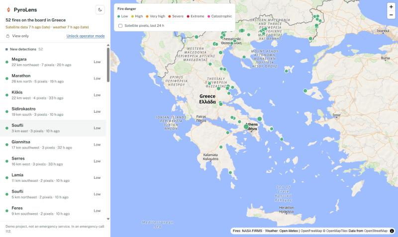
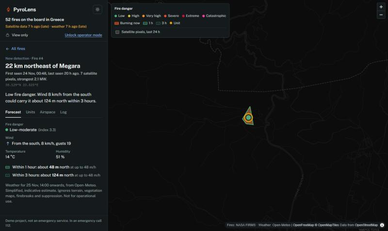
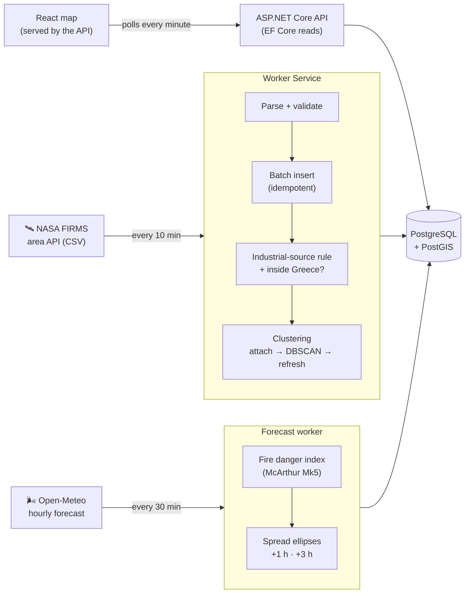

<div align="center">

# 🔥 PyroLens

**From satellite fire pixels to coordinated incidents.**

PyroLens ingests NASA satellite fire detections, groups them into incidents with PostGIS,
forecasts where each fire could spread in the next 1 and 3 hours, shows it all on a live map,
and (on the roadmap) helps a dispatcher coordinate resources, airspace and public alerts.

[](https://github.com/Nikolhs123/PyroLens/actions/workflows/ci.yml)


[](LICENSE)

**[Live demo → pyrolens.onrender.com](https://pyrolens.onrender.com)** · **[How it works: a guided tour of the code →](docs/GUIDE.md)**
<sub>Free hosting: the first visit after a quiet period can take up to a minute while the server wakes up.</sub>

</div>

> [!IMPORTANT]
> **Portfolio project, not an emergency tool.** In Greece, 112 and the competent authorities are the official source.
> Fire detections are real (NASA FIRMS); resources, citizen reports and sensors will be **simulated**.

---

<p align="center">
  
</p>
<p align="center">
  
</p>

## The problem

Fire maps such as foties.gr show **points**. A point is not an incident: it is not grouped with its neighbours,
it has no forecast, and nothing links it to crews, aircraft or alerts. PyroLens turns points into incidents
and builds coordination on top of them.

## What works today

### Phase 1: detections → incidents

- 🛰️ **FIRMS ingestion**: MODIS and VIIRS (NOAA-20, NOAA-21, Suomi NPP) every 10 minutes, with retries and timeouts.
- 🔁 **Idempotent writes**: one `INSERT … SELECT FROM unnest(…) ON CONFLICT DO NOTHING` per batch. Polls overlap on purpose and never duplicate.
- 🎚️ **Confidence filter**: MODIS > 70 %, VIIRS nominal/high (the foties.gr rule). Configurable, and changeable per API request.
- 🏭 **Industrial-source rule**: a spot that also burned on each of the previous 3 days (within 500 m) is flagged as a likely refinery or factory flare.
- 🇬🇷 **Greece only**: each detection is tested against the Greek boundary plus a 2 km buffer (Natural Earth, Greek point of view), cut into 120 pieces with `ST_Subdivide` behind a GIST index. Coastal pixels stay in; fires across the border are stored but never open incidents.
- 🧩 **Incident clustering**: new pixels join the nearest open incident (≤ 2 km). The rest are grouped with `ST_ClusterDBSCAN` in EPSG:2100 (Greek Grid, metres).
- 🩺 **Operations**: health checks, SQL migrations under an advisory lock, one clusterer at a time across instances.

A live run on 23 Nov 2026 fetched **271 detections** for the Greek bounding box: **131** fell inside Greece and became
**57 incidents**; the rest (western Turkey, the southern Balkans, open sea) were stored and left out. The whole cycle took under 3 seconds.

### Phase 2: weather and spread forecast

- 🌬️ **Weather**: hourly temperature, humidity and wind at each active incident from [Open-Meteo](https://open-meteo.com/), up to 50 locations per request.
- 🔥 **Fire danger**: McArthur Mk5 Forest Fire Danger Index (Noble et al., 1980), rated *low–moderate* to *catastrophic*.
- 📐 **Spread**: head-fire rate of spread `0.0012 × FFDI × fuel load`, an ellipse stretched downwind (length-to-breadth ratio from wind speed) and backing spread from the ellipse geometry, following CSIRO's Spark model library.
- 🗺️ **+1 h and +3 h areas**: each hour adds its own run in its own downwind direction, so the +3 h shape follows a turning wind. Stored as PostGIS polygons (convex hull of the current footprint and the ellipse) and served as GeoJSON.
- 🔁 **Upserts**: one row per incident, forecast hour and horizon, so a re-run within the hour updates instead of duplicating.

The first live forecast run covered all 57 incidents (114 forecasts) in one cycle. On a calm November night the index was
*low–moderate* everywhere, with spread rates around 35–45 m/h.

> [!WARNING]
> The spread estimate is **simplified and indicative**. It ignores terrain, real vegetation maps, firebreaks and firefighting,
> and uses a fixed drought factor and fuel load. The API says so in every response.

### Phase 3: dispatch (lifecycle, units, airspace)

Every guarantee below is enforced by PostgreSQL, not by checks in application code that a race could slip past.

- 🔄 **Incident lifecycle**: *Detected → Confirmed → Active → Contained → Closed*, plus false alarms (Detected → Closed)
  and flare-ups (Contained → Active), in one state machine. A change is one `UPDATE … WHERE status = <what the
  dispatcher saw>`: if someone moved the incident first, it updates nothing and the API answers **409 Conflict** with the
  current status. Closing releases every unit and cancels every airspace reservation of the incident.
- 📜 **Append-only timeline**: every action lands in `incident_events` with actor, note and details (JSONB). A trigger
  rejects `UPDATE` and `DELETE`, so the log cannot be rewritten.
- 🚒 **Units** (simulated fleet at real Greek bases: aircraft, helicopters, drones, engines, crews): suggestions by ETA
  (straight line for aircraft, ×1.3 by road), then **reserve** (a 5-minute hold) → **assign** → **release**. Each step is a
  single conditional `UPDATE`; the incident row is locked `FOR SHARE` so a unit can never be committed to an incident
  that is closing at the same moment. A `CHECK` constraint ties every status to exactly the columns it needs.
- ✈️ **Airspace**: reserve a circle and a time window around a fire, at **low** level (drones) or **high** (aircraft).
  An **exclusion constraint** — `EXCLUDE USING gist (level WITH =, area WITH &&, during WITH &&) WHERE (cancelled_at IS NULL)`
  on a `tstzrange` — makes overlapping reservations impossible; the API turns the violation (`23P01`) into a 409 that
  names the reservation in the way.
- 🔐 **Operator key**: reads are public; dispatcher actions need the `X-Operator-Key` header (constant-time comparison)
  and are rate-limited to 30 a minute per client. Without a configured key the server is read-only.

Measured in the integration tests: **20 concurrent reservations of one aircraft → exactly 1 succeeds, 19 get 409**;
**10 concurrent overlapping airspace requests → exactly 1 succeeds**.

### The web app

A React + TypeScript app (Vite, MapLibre GL, OpenFreeMap vector tiles, Public Sans), built into the API image and
served at `/`. It is written to be read by a person, not decoded:

- **Light and dark**: follows the system setting until you pick one with the sun/moon button; the map switches
  between OpenFreeMap's "liberty" and "dark" styles and keeps every overlay.
- **Fires named after places**: each fire is described from the nearest of about 90 Greek towns, e.g.
  *"9 km southwest of Feres"*, grouped by status (active, confirmed, contained, new detections), with the danger word
  and how long ago it was last seen. The header says how fresh the satellite and weather data are, and flags it as late
  when the scheduled jobs fall behind.
- **One fire**: a one-sentence summary (*"Low fire danger. Wind 8 km/h from the south could carry it about 124 m north
  within 3 hours."*), the allowed next steps, then four tabs. *Forecast*: danger, wind, temperature, humidity and the
  +1 h / +3 h runs. *Units*: units on this fire with a live hold countdown, and the closest free ones by travel time.
  *Airspace*: reservations and a form for new ones. *Log*: the timeline as sentences (*"Nick sent AIR-01."*). Conflicts
  come back as the server's own sentence, e.g. "High (aircraft) airspace there is already reserved 23:07–01:07 UTC by
  reservation 1".
- **Operator mode**: view only until the operator key is entered (kept for the browser tab only).
- **Map**: dots coloured by danger and sized by pixels; the selected fire's burning area, +1 h area and +3 h outline,
  its units with lines from their bases; airspace circles (teal low, violet high); optional raw pixels of the last 24 h.
  Refreshes every minute (units and airspace every 15 s). Keyboard: `Esc` back to the list, `P` pixel layer. On phones
  the map sits above the list.

## Architecture



| Project | Responsibility |
|---|---|
| `PyroLens.Core` | Domain types, FIRMS CSV and Open-Meteo parsers, fire danger and spread math (no dependencies) |
| `PyroLens.Infrastructure` | Schema and migrations, FIRMS and Open-Meteo clients, batch writer, clustering, forecasts |
| `PyroLens.Worker` | Two background loops: ingestion every 10 min, forecasts every 30 min |
| `PyroLens.Api` | REST endpoints (geometries as GeoJSON), health checks, serves the map |
| `web/` | React + TypeScript web app (Vite, MapLibre GL), with Vitest tests |

New to Docker, PostGIS or this codebase? **[docs/GUIDE.md](docs/GUIDE.md)** walks through every part, in the order the data flows.

<details>
<summary><b>How clustering works</b></summary>

All steps run in one transaction behind `pg_advisory_xact_lock`:

1. **Candidates**: unassigned detections from the last 24 h inside Greece (plus 2 km) that pass the confidence filter and are not flagged industrial.
2. **Attach**: each candidate joins the nearest open incident whose detections lie within 2 km (`ST_DWithin` on geography, KNN `<->` ordering).
3. **Cluster**: the remaining candidates are grouped with `ST_ClusterDBSCAN(eps = 1500 m, minpoints = 1)` after `ST_Transform` to EPSG:2100. Each cluster opens an incident.
4. **Refresh**: centroid, convex-hull footprint, first/last seen, count and max FRP are recomputed for every incident that changed.

</details>

## Quick start

Requirements: [.NET 9 SDK](https://dotnet.microsoft.com/download) and [Docker Desktop](https://www.docker.com/products/docker-desktop/).

```bash
git clone https://github.com/Nikolhs123/PyroLens.git
cd PyroLens
docker compose up --build
```

Then open **http://localhost:8080** for the map, or http://localhost:8080/api/incidents for the raw API.
The first forecasts appear about a minute after start-up.

- **Without a key**, the worker replays [`samples/firms_sample_synthetic.csv`](samples/firms_sample_synthetic.csv): a **synthetic** file, moved to today's date, that produces three incidents (Parnitha, North Evia, Rhodes), two filtered low-confidence pixels and one flagged industrial spot.
- **With real data**: get a free [FIRMS MAP_KEY](https://firms.modaps.eosdis.nasa.gov/api/map_key/), copy `.env.example` to `.env`, set `FIRMS_MAP_KEY`, and run `docker compose up` again.

<details>
<summary>Running from an IDE</summary>

```bash
docker compose up db
dotnet user-secrets set "Firms:Mode" "Api" --project src/PyroLens.Worker
dotnet user-secrets set "Firms:MapKey" "<your key>" --project src/PyroLens.Worker
dotnet run --project src/PyroLens.Worker
dotnet run --project src/PyroLens.Api
```

The Development settings point both services to `localhost:5432`.

Map with hot reload (needs Node 22; proxies `/api` to the API on port 8080). Without Node, `docker compose up --build`
builds the map into the API image instead.

```bash
cd web
npm ci
npm run dev
```
</details>

## API

| Endpoint | Description |
|---|---|
| `GET /api/status` | When satellite data and forecasts last arrived, how many incidents are active, and for each job (`ingestion`, `forecast`) its last success, who started it last (`worker`, `schedule`, `website`) and whether it is running now |
| `GET /api/incidents?hours=48&status=detected` | The board: incidents not closed that were detected in the last N hours or are being worked on, with footprint (GeoJSON), latest danger rating and allowed next statuses |
| `GET /api/incidents/{id}` | One incident with its detections |
| `GET /api/incidents/{id}/forecast` | Latest +1 h and +3 h forecast: weather, danger index and rating, spread rate, spread area as GeoJSON |
| `GET /api/incidents/{id}/events` | The incident's timeline |
| `GET /api/incidents/{id}/resources/suggestions?limit=6` | Free units by ETA, with distance |
| `GET /api/resources` · `GET /api/airspace?incidentId=` | The fleet with its state; live airspace reservations (GeoJSON areas) |
| `GET /api/detections?hours=24&modisConfidenceAbove=70&viirsConfidence=nominal,high&includeIndustrial=false&includeOutsideArea=false` | Raw detections with a per-request confidence filter; outside Greece hidden by default |
| `GET /health/live` · `GET /health/ready` | Liveness; readiness including PostgreSQL |

Dispatcher actions (header `X-Operator-Key`; 401 without it, 403 when the server is read-only, 429 above 30 a minute):

| Endpoint | Body | Outcomes |
|---|---|---|
| `POST /api/incidents/{id}/status` | `{ "from": "detected", "to": "confirmed", "note": "…" }` | 200 · 409 status changed meanwhile · 422 not an allowed transition |
| `POST /api/resources/{id}/reserve` | `{ "incidentId": 38 }` | 200 (5-minute hold) · 409 taken · 422 incident not confirmed |
| `POST /api/resources/{id}/assign` · `/release` | `{ "incidentId": 38 }` | 200 · 409 hold expired or not this incident's |
| `POST /api/incidents/{id}/airspace` | `{ "level": "high", "radiusMeters": 3000, "durationMinutes": 120 }` | 200 · 409 overlaps a reservation (named) · 422 invalid window |
| `DELETE /api/airspace/{id}` | – | 200 · 409 already cancelled |

<details>
<summary>Example response</summary>

```json
[
  {
    "id": 35,
    "status": "detected",
    "latitude": 39.6614875,
    "longitude": 22.713675,
    "firstDetectedAt": "2026-11-23T10:47:00+00:00",
    "lastDetectedAt": "2026-11-23T12:25:00+00:00",
    "detectionCount": 8,
    "maxFrpMegawatts": 34.3
  }
]
```
</details>

## Testing

```bash
dotnet test tests/PyroLens.UnitTests          # parsers, fire danger and spread math, lifecycle rules, ETAs
dotnet test tests/PyroLens.IntegrationTests   # real SQL on postgis/postgis via Testcontainers (needs Docker)
cd web && npm test                            # web app logic: sorting, town names, sentences, countdowns, times
```

**Phase 3 integration tests** run against PostGIS with a controllable clock: status changes and their timeline; a stale
change gets 409; the timeline refuses `UPDATE` and `DELETE` (`restrict_violation`); reserve → assign → release; a hold
blocks other incidents until it expires; **20 parallel reservations of one aircraft, exactly one winner**; suggestions in
ETA order; overlapping airspace refused by the exclusion constraint, other band and adjacent windows allowed;
**10 parallel overlapping airspace requests, exactly one winner**; closing an incident releases its units and airspace.
Job runs: a run is recorded with who started it; a job is skipped until its gap has passed; a run still going is left
alone until it looks stuck (15 minutes); a failed run keeps the last success; **10 processes starting the same job at
once, exactly one runs it**.

The unit tests check the FFDI equation and rating bands, spread rate, ellipse shape and orientation (a north wind pushes
the fire south, the width is length / LB, a turning wind bends the direction) and both parsers on real responses.
The integration tests cover idempotent re-ingestion, the three sample incidents, the industrial-source rule,
the Greece boundary (pixels 1 km offshore kept, open sea and the Turkish side of the Evros dropped),
attaching to an open incident, DBSCAN separation, options binding, and forecasts with fixed weather
(+1 h inside +3 h, head run matches the reach downwind, re-runs upsert). CI runs the .NET suites, typechecks, tests and
builds the map, and builds both Docker images.

## Roadmap

- [x] **Detection → incidents**: FIRMS ingestion, confidence filter, industrial rule, PostGIS clustering
- [x] **Forecast**: Open-Meteo weather, McArthur fire danger index, spread areas at +1 h and +3 h
- [x] **Map**: React + TypeScript dispatcher map with incidents, danger ratings and spread areas
- [ ] **Live push**: SignalR instead of polling, driven by PostgreSQL `LISTEN/NOTIFY` from the worker
- [ ] **Better forecast inputs**: rainfall-based drought factor, EFFIS Fire Weather Index, a fire danger map for all of Greece
- [x] **Incident lifecycle**: state machine from *Detected* to *Closed*, append-only timeline, optimistic 409 on races
- [x] **Resources**: simulated fleet, suggestions by ETA, expiring reservations and atomic assignment (`409 Conflict` on races)
- [x] **Airspace**: zone and time-window reservations enforced by a PostgreSQL exclusion constraint on `tstzrange`
- [ ] **Escalation rules**: flag incidents that grow, worsen in danger band or have no units after N minutes
- [ ] **LLM assistant**: incident summaries and draft announcements with structured output, fallback and human approval
- [ ] **Citizens**: public map served from cache, report form, radius-based alerts through a queue with dead-lettering
- [ ] **Scale**: k6 load tests (telemetry ingest, public map peak, resource races, airspace overlap) with before/after numbers
- [x] **Live demo** on free tiers: Supabase (PostGIS), GitHub Actions (scheduled jobs), Render (API and map)
- [ ] **Azure**: Container Apps, PostgreSQL Flexible Server and Entra sign-in, described in Bicep (ready, not deployed: about $15–20/month)

## Deployment

### Live demo (free)

| Part | Runs on | How |
|---|---|---|
| Database | [Supabase](https://supabase.com) free plan | PostgreSQL with PostGIS, reached through the session pooler (IPv4) |
| API and map | [Render](https://render.com) free web service ([`render.yaml`](render.yaml)) | Builds `src/PyroLens.Api/Dockerfile` and redeploys on every push to `main` |
| Ingestion and forecasts, on a visit | The same Render service ([`LiveRefreshService`](src/PyroLens.Api/LiveRefreshService.cs)) | While the site is awake it fetches fires when they are 10 minutes old and weather when it is 30 minutes old |
| Ingestion and forecasts, in between | GitHub Actions ([`scheduled-jobs.yml`](.github/workflows/scheduled-jobs.yml)) | Runs the published worker image with `--once ingestion` every 10 minutes and `--once forecast` at :05 and :35, as often as GitHub allows |

**Why two ways to run the jobs:** GitHub's free schedules are best-effort. On a busy day they ran 4 times instead of
about 200, so the site said its data was 7 hours old. Now the site fetches fresh data itself when someone opens it. Both
paths go through [`JobRunner`](src/PyroLens.Infrastructure/Jobs/JobRunner.cs), which records every run in `job_runs`
with one conditional `INSERT … ON CONFLICT DO UPDATE`. That way two processes never run the same job at once or right
after each other, and the sidebar can say *"Satellites checked 3 min ago"* or *"Checking satellites now…"*.

Secrets live only in the platforms: `DATABASE_URL` and `FIRMS_MAP_KEY` as GitHub repository secrets,
`ConnectionStrings__PyroLens` and `Firms__MapKey` as Render environment variables. The app accepts the `postgresql://…` URL exactly as
Supabase shows it. Forecasts older than 7 days are deleted to stay well inside the 500 MB free database.
The API starts even when the database is unreachable and reports it on `/health/ready`, so a bad setting never
takes the map down. Without `Firms__MapKey` the site does not fetch anything itself (it never loads the sample file
into a live database) and logs why.

Limits of the free setup: the web service sleeps after 15 minutes without visitors (the first visit then waits about a
minute, and new data follows within another minute), GitHub runs schedules irregularly, and GitHub pauses schedules
after 60 days without commits.

### Azure (prepared, not deployed)

[`deploy/azure`](deploy/azure) describes a production-style deployment in Bicep: PostgreSQL Flexible Server with
PostGIS and **Microsoft Entra sign-in only** (no database password; a managed identity gets short-lived tokens),
the FIRMS key in Key Vault, the API as a Container App that scales to zero, and the worker as two scheduled
Container Apps Jobs. CI already publishes the images to `ghcr.io`. It is not running because the database would
cost about $15–20 a month.

```powershell
az login
./deploy/azure/deploy.ps1 -Phase infra
az keyvault secret set --vault-name <printed name> --name firms-map-key --value <your key>
./deploy/azure/deploy.ps1 -Phase apps
```

## Configuration

Worker settings are in [`src/PyroLens.Worker/appsettings.json`](src/PyroLens.Worker/appsettings.json):
FIRMS products and fetch bounding box, poll interval, confidence rule, industrial rule, the Greece filter
(`DetectionFilter:RequireAreaOfInterest`), clustering distances, and the forecast interval, drought factor
(`Forecast:DroughtFactor`, 1–10, default 8) and fuel load (`Forecast:FuelLoadTonnesPerHectare`, default 12 t/ha).
Any value can be overridden with an environment variable, e.g. `Clustering__ClusterDistanceMeters=1000`.

The Greece boundary migration is generated by [`tools/build_area_migration.ps1`](tools/build_area_migration.ps1)
from the Natural Earth file; see the script for the steps.

## Data sources and attribution

| Source | Used for | Terms |
|---|---|---|
| [NASA FIRMS](https://firms.modaps.eosdis.nasa.gov/) | Active fire detections (MODIS, VIIRS) | Free MAP_KEY, rate-limited per 10 minutes. *We acknowledge the use of data and imagery from NASA's Fire Information for Resource Management System (FIRMS), part of NASA's Earth Science Data and Information System (ESDIS).* |
| [Natural Earth](https://www.naturalearthdata.com/) | Greek boundary (1:10m admin-0, Greek point of view) | Public domain |
| [Open-Meteo](https://open-meteo.com/) | Hourly temperature, humidity, wind | Free, no key, non-commercial use, fewer than 10,000 calls a day, CC BY 4.0 attribution. 57 incidents every 30 min is about 2,700 locations a day |
| [CSIRO Spark model library](https://research.csiro.au/spark/resources/model-library/mcarthur) | McArthur Mk5 equations, length-to-breadth ratio, ellipse geometry | Published reference implementation |
| EFFIS *(roadmap)* | Fire Weather Index | EFFIS terms of use |
| [OpenFreeMap](https://openfreemap.org) | Vector map tiles, light and dark | Free, no key, no usage limits; provided as-is. Map data © [OpenMapTiles](https://openmaptiles.org), © [OpenStreetMap](https://www.openstreetmap.org/copyright) contributors (ODbL) |

Terms and limits change; check each provider before deploying.

## Known limitations

- The 1:10m boundary leaves out the smallest islets (e.g. Kastellorizo); the 2 km buffer covers coastal pixels of the islands it includes.
- Flares from refineries and factories are reduced by the confidence filter and the consecutive-days rule, not eliminated.
- The industrial rule flags the newest detection only; earlier detections of the same spot keep their incident.
- Incidents that grow into each other are not merged yet.
- The spread model was built for eucalypt forest (McArthur Mk5). Greek fuels differ, so the absolute numbers are indicative; the drought factor and fuel load are fixed settings, not measured.
- Each spread ellipse starts at the incident centre, and weather is taken at that one point.

## License

[MIT](LICENSE) © 2026 Nick Marmaras
