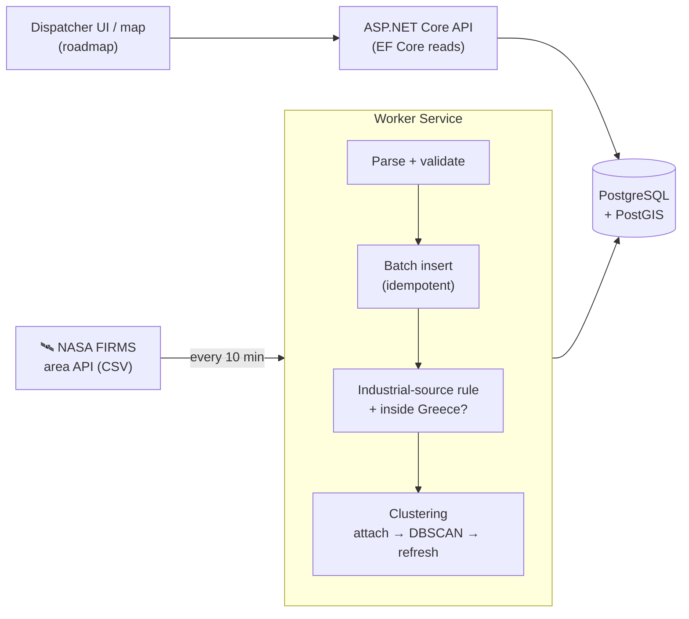

<div align="center">

# 🔥 PyroLens

**From satellite fire pixels to coordinated incidents.**

PyroLens ingests NASA satellite fire detections, groups them into incidents with PostGIS,
and (on the roadmap) forecasts their spread and helps a dispatcher coordinate resources,
airspace and public alerts.

[](https://github.com/Nikolhs123/PyroLens/actions/workflows/ci.yml)


[](LICENSE)

</div>

> [!IMPORTANT]
> **Portfolio project, not an emergency tool.** In Greece, 112 and the competent authorities are the official source.
> Fire detections are real (NASA FIRMS); resources, citizen reports and sensors will be **simulated**.

---

## The problem

Fire maps such as foties.gr show **points**. A point is not an incident: it is not grouped with its neighbours,
it has no forecast, and nothing links it to crews, aircraft or alerts. PyroLens turns points into incidents
and builds coordination on top of them.

## What works today (Phase 1)

- 🛰️ **FIRMS ingestion**: MODIS and VIIRS (NOAA-20, NOAA-21, Suomi NPP) every 10 minutes, with retries and timeouts.
- 🔁 **Idempotent writes**: one `INSERT … SELECT FROM unnest(…) ON CONFLICT DO NOTHING` per batch. Polls overlap on purpose and never duplicate.
- 🎚️ **Confidence filter**: MODIS > 70 %, VIIRS nominal/high (the foties.gr rule). Configurable, and changeable per API request.
- 🏭 **Industrial-source rule**: a spot that also burned on each of the previous 3 days (within 500 m) is flagged as a likely refinery or factory flare.
- 🇬🇷 **Greece only**: each detection is tested against the Greek boundary plus a 2 km buffer (Natural Earth, Greek point of view), cut into 120 pieces with `ST_Subdivide` behind a GIST index. Coastal pixels stay in; fires across the border are stored but never open incidents.
- 🧩 **Incident clustering**: new pixels join the nearest open incident (≤ 2 km). The rest are grouped with `ST_ClusterDBSCAN` in EPSG:2100 (Greek Grid, metres).
- 🩺 **Operations**: health checks, SQL migrations under an advisory lock, one clusterer at a time across instances.

A live run on 23 Nov 2026 fetched **271 detections** for the Greek bounding box: **131** fell inside Greece and became
**57 incidents**; the rest (western Turkey, the southern Balkans, open sea) were stored and left out. The whole cycle took under 3 seconds.

## Architecture



| Project | Responsibility |
|---|---|
| `PyroLens.Core` | Domain types and the FIRMS CSV parser (no dependencies) |
| `PyroLens.Infrastructure` | Schema and migrations, FIRMS client, batch writer, clustering |
| `PyroLens.Worker` | Background polling loop |
| `PyroLens.Api` | REST endpoints and health checks |

<details>
<summary><b>How clustering works</b></summary>

All steps run in one transaction behind `pg_advisory_xact_lock`:

1. **Candidates**: unassigned detections from the last 24 h inside Greece (plus 2 km) that pass the confidence filter and are not flagged industrial.
2. **Attach**: each candidate joins the nearest open incident whose detections lie within 2 km (`ST_DWithin` on geography, KNN `<->` ordering).
3. **Cluster**: the remaining candidates are grouped with `ST_ClusterDBSCAN(eps = 1500 m, minpoints = 1)` after `ST_Transform` to EPSG:2100. Each cluster opens an incident.
4. **Refresh**: centroid, convex-hull footprint, first/last seen, count and max FRP are recomputed for every incident that changed.

</details>

## Quick start

Requirements: [.NET 9 SDK](https://dotnet.microsoft.com/download) and [Docker Desktop](https://www.docker.com/products/docker-desktop/).

```bash
git clone https://github.com/Nikolhs123/PyroLens.git
cd PyroLens
docker compose up --build
```

Then open http://localhost:8080/api/incidents.

- **Without a key**, the worker replays [`samples/firms_sample_synthetic.csv`](samples/firms_sample_synthetic.csv): a **synthetic** file, moved to today's date, that produces three incidents (Parnitha, North Evia, Rhodes), two filtered low-confidence pixels and one flagged industrial spot.
- **With real data**: get a free [FIRMS MAP_KEY](https://firms.modaps.eosdis.nasa.gov/api/map_key/), copy `.env.example` to `.env`, set `FIRMS_MAP_KEY`, and run `docker compose up` again.

<details>
<summary>Running from an IDE</summary>

```bash
docker compose up db
dotnet user-secrets set "Firms:Mode" "Api" --project src/PyroLens.Worker
dotnet user-secrets set "Firms:MapKey" "<your key>" --project src/PyroLens.Worker
dotnet run --project src/PyroLens.Worker
dotnet run --project src/PyroLens.Api
```

The Development settings point both services to `localhost:5432`.
</details>

## API

| Endpoint | Description |
|---|---|
| `GET /api/incidents?hours=48&status=detected` | Incidents with a detection in the last N hours, newest first |
| `GET /api/incidents/{id}` | One incident with its detections |
| `GET /api/detections?hours=24&modisConfidenceAbove=70&viirsConfidence=nominal,high&includeIndustrial=false&includeOutsideArea=false` | Raw detections with a per-request confidence filter; outside Greece hidden by default |
| `GET /health/live` · `GET /health/ready` | Liveness; readiness including PostgreSQL |

<details>
<summary>Example response</summary>

```json
[
  {
    "id": 35,
    "status": "detected",
    "latitude": 39.6614875,
    "longitude": 22.713675,
    "firstDetectedAt": "2026-11-23T10:47:00+00:00",
    "lastDetectedAt": "2026-11-23T12:25:00+00:00",
    "detectionCount": 8,
    "maxFrpMegawatts": 34.3
  }
]
```
</details>

## Testing

```bash
dotnet test tests/PyroLens.UnitTests          # parser and validation, no dependencies
dotnet test tests/PyroLens.IntegrationTests   # real SQL on postgis/postgis via Testcontainers (needs Docker)
```

The integration tests cover idempotent re-ingestion, the three sample incidents, the industrial-source rule,
the Greece boundary (pixels 1 km offshore kept, open sea and the Turkish side of the Evros dropped),
attaching to an open incident, DBSCAN separation and options binding. CI runs both suites and builds the Docker images.

## Roadmap

- [x] **Detection → incidents**: FIRMS ingestion, confidence filter, industrial rule, PostGIS clustering
- [ ] **Forecast**: wind and humidity (Open-Meteo), Fire Weather Index (EFFIS), spread estimate at +1 h and +3 h
- [ ] **Incident lifecycle**: state machine from *Detected* to *Closed*, timeline, escalation rules, audit log
- [ ] **Resources**: crews, tankers, aircraft and drones with atomic assignment (`409 Conflict` on races)
- [ ] **Airspace**: zone and time-window reservations enforced by a PostgreSQL exclusion constraint on `tstzrange`
- [ ] **LLM assistant**: incident summaries and draft announcements with structured output, fallback and human approval
- [ ] **Citizens**: public map served from cache, report form, radius-based alerts through a queue with dead-lettering
- [ ] **Scale**: k6 load tests (telemetry ingest, public map peak, resource races, airspace overlap) with before/after numbers
- [ ] **Cloud**: Azure Container Apps and PostgreSQL Flexible Server, deployed from GitHub Actions

## Configuration

Worker settings are in [`src/PyroLens.Worker/appsettings.json`](src/PyroLens.Worker/appsettings.json):
FIRMS products and fetch bounding box, poll interval, confidence rule, industrial rule, the Greece filter
(`DetectionFilter:RequireAreaOfInterest`) and clustering distances.
Any value can be overridden with an environment variable, e.g. `Clustering__ClusterDistanceMeters=1000`.

The Greece boundary migration is generated by [`tools/build_area_migration.ps1`](tools/build_area_migration.ps1)
from the Natural Earth file; see the script for the steps.

## Data sources and attribution

| Source | Used for | Terms |
|---|---|---|
| [NASA FIRMS](https://firms.modaps.eosdis.nasa.gov/) | Active fire detections (MODIS, VIIRS) | Free MAP_KEY, rate-limited per 10 minutes. *We acknowledge the use of data and imagery from NASA's Fire Information for Resource Management System (FIRMS), part of NASA's Earth Science Data and Information System (ESDIS).* |
| [Natural Earth](https://www.naturalearthdata.com/) | Greek boundary (1:10m admin-0, Greek point of view) | Public domain |
| Open-Meteo *(roadmap)* | Wind, humidity, temperature | Non-commercial use, CC BY 4.0 attribution |
| EFFIS *(roadmap)* | Fire Weather Index | EFFIS terms of use |
| OpenStreetMap *(roadmap)* | Settlements and roads | © OpenStreetMap contributors |

Terms and limits change; check each provider before deploying.

## Known limitations

- The 1:10m boundary leaves out the smallest islets (e.g. Kastellorizo); the 2 km buffer covers coastal pixels of the islands it includes.
- Flares from refineries and factories are reduced by the confidence filter and the consecutive-days rule, not eliminated.
- The industrial rule flags the newest detection only; earlier detections of the same spot keep their incident.
- Incidents that grow into each other are not merged yet.

## License

[MIT](LICENSE) © 2026 Nick Marmaras
