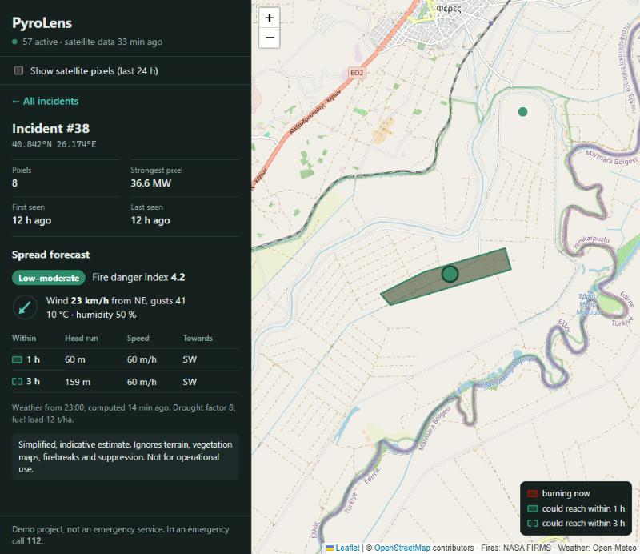
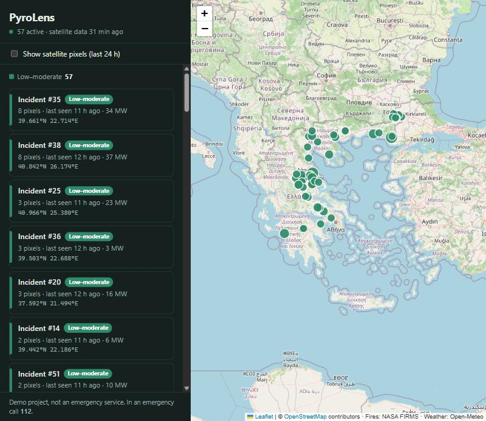
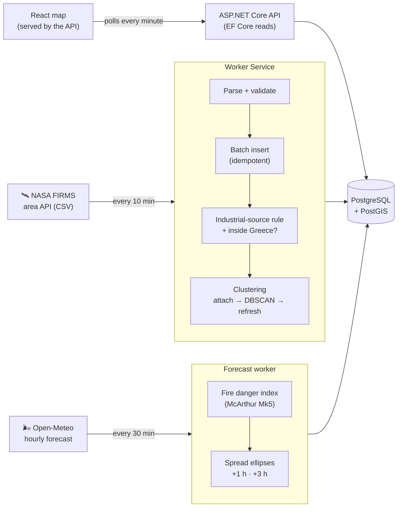

<div align="center">

# 🔥 PyroLens

**From satellite fire pixels to coordinated incidents.**

PyroLens ingests NASA satellite fire detections, groups them into incidents with PostGIS,
forecasts where each fire could spread in the next 1 and 3 hours, shows it all on a live map,
and (on the roadmap) helps a dispatcher coordinate resources, airspace and public alerts.

[](https://github.com/Nikolhs123/PyroLens/actions/workflows/ci.yml)


[](LICENSE)

</div>

> [!IMPORTANT]
> **Portfolio project, not an emergency tool.** In Greece, 112 and the competent authorities are the official source.
> Fire detections are real (NASA FIRMS); resources, citizen reports and sensors will be **simulated**.

---

<p align="center">
  
</p>

## The problem

Fire maps such as foties.gr show **points**. A point is not an incident: it is not grouped with its neighbours,
it has no forecast, and nothing links it to crews, aircraft or alerts. PyroLens turns points into incidents
and builds coordination on top of them.

## What works today

### Phase 1: detections → incidents

- 🛰️ **FIRMS ingestion**: MODIS and VIIRS (NOAA-20, NOAA-21, Suomi NPP) every 10 minutes, with retries and timeouts.
- 🔁 **Idempotent writes**: one `INSERT … SELECT FROM unnest(…) ON CONFLICT DO NOTHING` per batch. Polls overlap on purpose and never duplicate.
- 🎚️ **Confidence filter**: MODIS > 70 %, VIIRS nominal/high (the foties.gr rule). Configurable, and changeable per API request.
- 🏭 **Industrial-source rule**: a spot that also burned on each of the previous 3 days (within 500 m) is flagged as a likely refinery or factory flare.
- 🇬🇷 **Greece only**: each detection is tested against the Greek boundary plus a 2 km buffer (Natural Earth, Greek point of view), cut into 120 pieces with `ST_Subdivide` behind a GIST index. Coastal pixels stay in; fires across the border are stored but never open incidents.
- 🧩 **Incident clustering**: new pixels join the nearest open incident (≤ 2 km). The rest are grouped with `ST_ClusterDBSCAN` in EPSG:2100 (Greek Grid, metres).
- 🩺 **Operations**: health checks, SQL migrations under an advisory lock, one clusterer at a time across instances.

A live run on 23 Nov 2026 fetched **271 detections** for the Greek bounding box: **131** fell inside Greece and became
**57 incidents**; the rest (western Turkey, the southern Balkans, open sea) were stored and left out. The whole cycle took under 3 seconds.

### Phase 2: weather and spread forecast

- 🌬️ **Weather**: hourly temperature, humidity and wind at each active incident from [Open-Meteo](https://open-meteo.com/), up to 50 locations per request.
- 🔥 **Fire danger**: McArthur Mk5 Forest Fire Danger Index (Noble et al., 1980), rated *low–moderate* to *catastrophic*.
- 📐 **Spread**: head-fire rate of spread `0.0012 × FFDI × fuel load`, an ellipse stretched downwind (length-to-breadth ratio from wind speed) and backing spread from the ellipse geometry, following CSIRO's Spark model library.
- 🗺️ **+1 h and +3 h areas**: each hour adds its own run in its own downwind direction, so the +3 h shape follows a turning wind. Stored as PostGIS polygons (convex hull of the current footprint and the ellipse) and served as GeoJSON.
- 🔁 **Upserts**: one row per incident, forecast hour and horizon, so a re-run within the hour updates instead of duplicating.

The first live forecast run covered all 57 incidents (114 forecasts) in one cycle. On a calm November night the index was
*low–moderate* everywhere, with spread rates around 35–45 m/h.

> [!WARNING]
> The spread estimate is **simplified and indicative**. It ignores terrain, real vegetation maps, firebreaks and firefighting,
> and uses a fixed drought factor and fuel load. The API says so in every response.

### Map

A React + TypeScript app (Vite, Leaflet, OpenStreetMap tiles), built into the API image and served at `/`.

- Every active incident as a marker coloured by its +3 h danger rating, sized by its number of satellite pixels.
- A list sorted by danger, then size, then recency, with a count per rating.
- Selecting an incident zooms to it and shows where it is burning now, where it could be within 1 h and 3 h,
  the wind (with an arrow), temperature, humidity, spread speed and direction, and the disclaimer.
- An optional layer with the raw satellite pixels of the last 24 h.
- Refreshes every minute and says how fresh the satellite data is; works on phones (map above, list below).

<p align="center">
  
</p>

## Architecture



| Project | Responsibility |
|---|---|
| `PyroLens.Core` | Domain types, FIRMS CSV and Open-Meteo parsers, fire danger and spread math (no dependencies) |
| `PyroLens.Infrastructure` | Schema and migrations, FIRMS and Open-Meteo clients, batch writer, clustering, forecasts |
| `PyroLens.Worker` | Two background loops: ingestion every 10 min, forecasts every 30 min |
| `PyroLens.Api` | REST endpoints (geometries as GeoJSON), health checks, serves the map |
| `web/` | React + TypeScript map (Vite, Leaflet), with Vitest tests |

<details>
<summary><b>How clustering works</b></summary>

All steps run in one transaction behind `pg_advisory_xact_lock`:

1. **Candidates**: unassigned detections from the last 24 h inside Greece (plus 2 km) that pass the confidence filter and are not flagged industrial.
2. **Attach**: each candidate joins the nearest open incident whose detections lie within 2 km (`ST_DWithin` on geography, KNN `<->` ordering).
3. **Cluster**: the remaining candidates are grouped with `ST_ClusterDBSCAN(eps = 1500 m, minpoints = 1)` after `ST_Transform` to EPSG:2100. Each cluster opens an incident.
4. **Refresh**: centroid, convex-hull footprint, first/last seen, count and max FRP are recomputed for every incident that changed.

</details>

## Quick start

Requirements: [.NET 9 SDK](https://dotnet.microsoft.com/download) and [Docker Desktop](https://www.docker.com/products/docker-desktop/).

```bash
git clone https://github.com/Nikolhs123/PyroLens.git
cd PyroLens
docker compose up --build
```

Then open **http://localhost:8080** for the map, or http://localhost:8080/api/incidents for the raw API.
The first forecasts appear about a minute after start-up.

- **Without a key**, the worker replays [`samples/firms_sample_synthetic.csv`](samples/firms_sample_synthetic.csv): a **synthetic** file, moved to today's date, that produces three incidents (Parnitha, North Evia, Rhodes), two filtered low-confidence pixels and one flagged industrial spot.
- **With real data**: get a free [FIRMS MAP_KEY](https://firms.modaps.eosdis.nasa.gov/api/map_key/), copy `.env.example` to `.env`, set `FIRMS_MAP_KEY`, and run `docker compose up` again.

<details>
<summary>Running from an IDE</summary>

```bash
docker compose up db
dotnet user-secrets set "Firms:Mode" "Api" --project src/PyroLens.Worker
dotnet user-secrets set "Firms:MapKey" "<your key>" --project src/PyroLens.Worker
dotnet run --project src/PyroLens.Worker
dotnet run --project src/PyroLens.Api
```

The Development settings point both services to `localhost:5432`.

Map with hot reload (needs Node 22; proxies `/api` to the API on port 8080). Without Node, `docker compose up --build`
builds the map into the API image instead.

```bash
cd web
npm ci
npm run dev
```
</details>

## API

| Endpoint | Description |
|---|---|
| `GET /api/status` | When satellite data and forecasts last arrived, and how many incidents are active |
| `GET /api/incidents?hours=48&status=detected` | Incidents with a detection in the last N hours, newest first, with footprint (GeoJSON) and latest danger rating |
| `GET /api/incidents/{id}` | One incident with its detections |
| `GET /api/incidents/{id}/forecast` | Latest +1 h and +3 h forecast: weather, danger index and rating, spread rate, spread area as GeoJSON |
| `GET /api/detections?hours=24&modisConfidenceAbove=70&viirsConfidence=nominal,high&includeIndustrial=false&includeOutsideArea=false` | Raw detections with a per-request confidence filter; outside Greece hidden by default |
| `GET /health/live` · `GET /health/ready` | Liveness; readiness including PostgreSQL |

<details>
<summary>Example response</summary>

```json
[
  {
    "id": 35,
    "status": "detected",
    "latitude": 39.6614875,
    "longitude": 22.713675,
    "firstDetectedAt": "2026-11-23T10:47:00+00:00",
    "lastDetectedAt": "2026-11-23T12:25:00+00:00",
    "detectionCount": 8,
    "maxFrpMegawatts": 34.3
  }
]
```
</details>

## Testing

```bash
dotnet test tests/PyroLens.UnitTests          # parsers, fire danger and spread math, no dependencies
dotnet test tests/PyroLens.IntegrationTests   # real SQL on postgis/postgis via Testcontainers (needs Docker)
cd web && npm test                            # map helpers: sorting by danger, rating counts, compass, distances, times
```

The unit tests check the FFDI equation and rating bands, spread rate, ellipse shape and orientation (a north wind pushes
the fire south, the width is length / LB, a turning wind bends the direction) and both parsers on real responses.
The integration tests cover idempotent re-ingestion, the three sample incidents, the industrial-source rule,
the Greece boundary (pixels 1 km offshore kept, open sea and the Turkish side of the Evros dropped),
attaching to an open incident, DBSCAN separation, options binding, and forecasts with fixed weather
(+1 h inside +3 h, head run matches the reach downwind, re-runs upsert). CI runs the .NET suites, typechecks, tests and
builds the map, and builds both Docker images.

## Roadmap

- [x] **Detection → incidents**: FIRMS ingestion, confidence filter, industrial rule, PostGIS clustering
- [x] **Forecast**: Open-Meteo weather, McArthur fire danger index, spread areas at +1 h and +3 h
- [x] **Map**: React + TypeScript dispatcher map with incidents, danger ratings and spread areas
- [ ] **Live push**: SignalR instead of polling, driven by PostgreSQL `LISTEN/NOTIFY` from the worker
- [ ] **Better forecast inputs**: rainfall-based drought factor, EFFIS Fire Weather Index, a fire danger map for all of Greece
- [ ] **Incident lifecycle**: state machine from *Detected* to *Closed*, timeline, escalation rules, audit log
- [ ] **Resources**: crews, tankers, aircraft and drones with atomic assignment (`409 Conflict` on races)
- [ ] **Airspace**: zone and time-window reservations enforced by a PostgreSQL exclusion constraint on `tstzrange`
- [ ] **LLM assistant**: incident summaries and draft announcements with structured output, fallback and human approval
- [ ] **Citizens**: public map served from cache, report form, radius-based alerts through a queue with dead-lettering
- [ ] **Scale**: k6 load tests (telemetry ingest, public map peak, resource races, airspace overlap) with before/after numbers
- [ ] **Cloud**: Azure Container Apps and PostgreSQL Flexible Server, deployed from GitHub Actions

## Configuration

Worker settings are in [`src/PyroLens.Worker/appsettings.json`](src/PyroLens.Worker/appsettings.json):
FIRMS products and fetch bounding box, poll interval, confidence rule, industrial rule, the Greece filter
(`DetectionFilter:RequireAreaOfInterest`), clustering distances, and the forecast interval, drought factor
(`Forecast:DroughtFactor`, 1–10, default 8) and fuel load (`Forecast:FuelLoadTonnesPerHectare`, default 12 t/ha).
Any value can be overridden with an environment variable, e.g. `Clustering__ClusterDistanceMeters=1000`.

The Greece boundary migration is generated by [`tools/build_area_migration.ps1`](tools/build_area_migration.ps1)
from the Natural Earth file; see the script for the steps.

## Data sources and attribution

| Source | Used for | Terms |
|---|---|---|
| [NASA FIRMS](https://firms.modaps.eosdis.nasa.gov/) | Active fire detections (MODIS, VIIRS) | Free MAP_KEY, rate-limited per 10 minutes. *We acknowledge the use of data and imagery from NASA's Fire Information for Resource Management System (FIRMS), part of NASA's Earth Science Data and Information System (ESDIS).* |
| [Natural Earth](https://www.naturalearthdata.com/) | Greek boundary (1:10m admin-0, Greek point of view) | Public domain |
| [Open-Meteo](https://open-meteo.com/) | Hourly temperature, humidity, wind | Free, no key, non-commercial use, fewer than 10,000 calls a day, CC BY 4.0 attribution. 57 incidents every 30 min is about 2,700 locations a day |
| [CSIRO Spark model library](https://research.csiro.au/spark/resources/model-library/mcarthur) | McArthur Mk5 equations, length-to-breadth ratio, ellipse geometry | Published reference implementation |
| EFFIS *(roadmap)* | Fire Weather Index | EFFIS terms of use |
| [OpenStreetMap](https://www.openstreetmap.org/copyright) | Map tiles | © OpenStreetMap contributors (ODbL). The public tile servers follow a [usage policy](https://operations.osmfoundation.org/policies/tiles/): fine for a demo, a hosted deployment with real traffic needs its own or a commercial tile provider |

Terms and limits change; check each provider before deploying.

## Known limitations

- The 1:10m boundary leaves out the smallest islets (e.g. Kastellorizo); the 2 km buffer covers coastal pixels of the islands it includes.
- Flares from refineries and factories are reduced by the confidence filter and the consecutive-days rule, not eliminated.
- The industrial rule flags the newest detection only; earlier detections of the same spot keep their incident.
- Incidents that grow into each other are not merged yet.
- The spread model was built for eucalypt forest (McArthur Mk5). Greek fuels differ, so the absolute numbers are indicative; the drought factor and fuel load are fixed settings, not measured.
- Each spread ellipse starts at the incident centre, and weather is taken at that one point.

## License

[MIT](LICENSE) © 2026 Nick Marmaras
